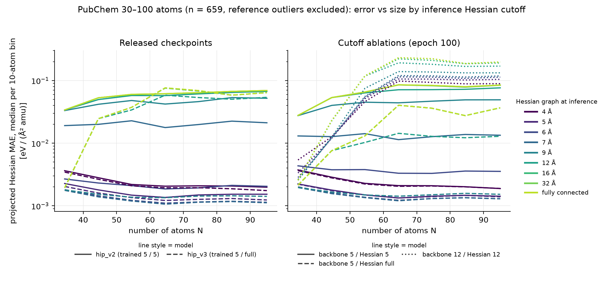

# hip_v2 vs hip_v3: graph-cutoff bug and cutoff ablation

**Question.** On the PubChem 30–100-atom set, why does the released `hip_v2.ckpt` generalise better
than `hip_v3.ckpt`?

**Answer so far.**
1. Both released checkpoints were trained with a **5 Å backbone graph** (`max_radius=5.0`,
   `max_neighbors=32`), not the 12 Å graph of the paper model `hesspred_v1`.
2. Until 2026-05-03, the training code also built the **Hessian graph** from the backbone cutoff and
   neighbour cap. The configured `cutoff_hessian=100` only set the range of the Hessian-edge distance
   expansion, so hip_v2 was effectively trained as **5 Å backbone / 5 Å Hessian**.
3. In a controlled ablation (identical settings except the cutoffs), **5 Å / 5 Å generalises to
   large molecules by far the best**. Its Hessian MAE is about 19× lower than 5 Å / fully connected
   and about 80× lower than 12 Å / 12 Å, although all three match on T1x validation.
4. The released checkpoints were also evaluated under different conditions: hip_v2 with
   `max_neighbors=1000`, hip_v3 with `max_neighbors=32`. With a 5 Å radius, a 32-neighbour cap
   truncates the graph of 26% of atoms (550/710 molecules) in the PubChem set, but never applies to
   T1x training molecules (< 32 atoms). A controlled re-evaluation is in
   [Released checkpoints](#released-checkpoints-on-all-710-molecules-same-projected-evaluator). The
   cap changes the PubChem results by less than 2%.
5. **Update (behavioural probe).** hip_v2 was trained 5 Å / 5 Å and hip_v3 5 Å / fully connected. On
   PubChem, what matters most is the Hessian graph used **at inference**. Evaluated with a 5 Å Hessian
   graph, hip_v3 and the ablation trained fully connected are as accurate as 5 Å / 5 Å (median raw
   Hessian MAE ≈ 0.005 eV/Ų). Evaluated fully connected, every model is 15–70× worse. The 12 Å
   backbone fails under both settings.

## 1. Evidence for the bug

### Released checkpoints (`hyper_parameters` read from the Hugging Face files)

| checkpoint (HF commit) | uploaded | backbone `max_radius` | `max_neighbors` | `cutoff_hessian` | train set (HORM Kaggle) | epochs |
|---|---|---|---|---|---|---|
| `hesspred_v1.ckpt` ([3a0aef9d](https://huggingface.co/andreasburger/hip/tree/3a0aef9d/ckpt)) | 2025-09 | 12.0 (precomputed graph, `otf_graph=False`) | 20 | 100 | v5 `ts1x_hess_train_big-hesspred` + RGD1 | 262 |
| `hip_v2.ckpt` original ([3a0aef9d](https://huggingface.co/andreasburger/hip/commit/3a0aef9d)) | 2025-10-20 | **5.0** | 32 | 100 | v5 `ts1x_hess_train_big` | 1144 |
| `hip_v2.ckpt` re-upload ([d3abd854](https://huggingface.co/andreasburger/hip/commit/d3abd854)) | 2026-06-12 | 5.0 | **1000** | 100 | same; weights bit-identical | 1144 |
| `hip_v3.ckpt` ([49095693](https://huggingface.co/andreasburger/hip/commit/49095693)) | 2026-05-06 | **5.0** | 32 | 100 | v6 `ts1x_hess_train` (byte-identical to v5 `train_big`) | 1108 |

The graph settings of hip_v2 and hip_v3 are identical. The backbone RBF buffer
`distance_expansion.offset` in the weights spans 0–5 Å in both (0–12 Å in `hesspred_v1`). The buffer
is fixed at construction and restored on every resume, so both models used 5 Å from the first step.

The training data are also identical. HORM v6 `ts1x_hess_train.lmdb` has the same SHA-256 as v5
`ts1x_hess_train_big.lmdb` (`a404b9eb…`); v6 only renamed it and dropped the `.h5`/`.json`
side files. `ts1x-val.lmdb` is byte-identical too (`aab37592…`). The energy target is the LMDB `ae`
field in every code version, with no E0 or atom-reference transform.

The remaining saved differences are optimiser, schedule and length:
- v2: lr 3e-4, betas (0.8, 0.95), Muon lr 0.02, weight decay 1e-5 (Muon 0.01), cosine T_max 800
  with 40 warm-up epochs, 1144 epochs.
- v3: lr 4.4e-4, betas (0.965, 0.965), Muon lr 1e-3, weight decay 2e-5 (Muon 1e-3), T_max 300 with
  10 warm-up epochs, 1108 epochs.

### Code at the time hip_v2 was uploaded (commit [744423b](https://github.com/BurgerAndreas/hip/tree/744423bec207ed3092462eaf18c8e39116a31b20), 2025-10-20)

- The 5 Å / 32 override was added to `configs/train.yaml` on 2025-09-23 in
  [81bf018](https://github.com/BurgerAndreas/hip/commit/81bf018c3229a250f50f2b930bae6fd32ed44e08)
  ("preprocess datasets") and was still present when hip_v2 was uploaded
  ([train.yaml L20-22](https://github.com/BurgerAndreas/hip/blob/744423bec207ed3092462eaf18c8e39116a31b20/configs/train.yaml#L20-L22)).
  It overrides the model default of 12 Å / 20 neighbours in `configs/equiformer_v2.yaml`.
- Backbone graph: `generate_graph_nopbc` calls `radius_graph(pos, r=self.cutoff)`
  ([L662-683](https://github.com/BurgerAndreas/hip/blob/744423bec207ed3092462eaf18c8e39116a31b20/nets/equiformer_v2/equiformer_v2_oc20.py#L662-L683)).
- Hessian graph: with `otfgraph_in_model=True`, training calls `forward(otf_graph=True)`
  ([training_module.py L565-569](https://github.com/BurgerAndreas/hip/blob/744423bec207ed3092462eaf18c8e39116a31b20/hip/training_module.py#L565-L569)).
  The forward pass then calls `add_graph_batch(data, cutoff=self.cutoff, max_neighbors=self.max_neighbors)`
  ([L731-738](https://github.com/BurgerAndreas/hip/blob/744423bec207ed3092462eaf18c8e39116a31b20/nets/equiformer_v2/equiformer_v2_oc20.py#L731-L738)),
  which builds the Hessian graph with the backbone cutoff
  ([hessian_pred_utils.py L380-421](https://github.com/BurgerAndreas/hip/blob/744423bec207ed3092462eaf18c8e39116a31b20/nets/equiformer_v2/hessian_pred_utils.py#L380-L421)).
  `cutoff_hessian` is only used for the Hessian-edge RBF range.
- [f0c441f](https://github.com/BurgerAndreas/hip/commit/f0c441fb784182e10c5c8fa304376880524ea7a5)
  (2025-11-14) renamed `max_radius` to `cutoff` and kept 5 Å.
  [a8c44d9](https://github.com/BurgerAndreas/hip/commit/a8c44d99c96d352a6f66436805201e5baab6de13)
  (2026-05-03, three days before hip_v3 was uploaded) introduced the fully connected Hessian graph,
  `fully_connected_hessian=True`, as the default. Current evaluation code therefore runs both
  released models with a fully connected Hessian graph that neither was trained on.
- Current code caps the backbone at `max_num_neighbors=self.max_neighbors`
  ([equiformer_v2_oc20.py L690](https://github.com/BurgerAndreas/hip/blob/natcompsci-rebuttal/nets/equiformer_v2/equiformer_v2_oc20.py#L690)),
  so `hip_v3.ckpt`/`hip_v3.yaml` as shipped (32) are truncated on molecules with more than 32 atoms.

Neighbour counts on the PubChem set: at 5 Å, a mean of 27.4 and a maximum of 75 neighbours, with
25.9% of atoms above 32. At 7 Å, a mean of 43.4 and 75.5% above 32. At 12 Å, a mean of 64.8 and a
maximum of 99.

### Existing released-model results (separate runs on the NVIDIA cluster, raw PubChem metrics, eV/Ų)

From `results_eval_largehessians_orca_hip_v{2,3}` and `..._hf_horm_eqv2_autograd` on this branch.

| model | eval `max_neighbors` | Hessian MAE mean (median) | Hessian RMSE mean (median) | Eckart eigval MAE mean (median) |
|---|---|---|---|---|
| hip_v2 | 1000 | 0.388 (0.293) | 2.70 (0.99) | 4.79 (0.44) |
| hip_v3 | 32 | 0.350 (0.227) | 3.61 (2.30) | 6.14 (1.71) |
| HORM EqV2 (autograd) | – | 0.564 (0.448) | 4.36 (2.59) | 10.8 (7.12) |

## 2. Controlled cutoff ablation (killarney, L40S)

All variants share seed 20261102, the hip_v3 optimiser, HORM v5 `ts1x_hess_train_big`, batch size 64,
`limit_train_batches=0.1`, `max_neighbors=1000` (uncapped) and 100 epochs (269,500 steps). Training
code: `hip-neighbors-retrain-20261102` at
[40cc830](https://github.com/BurgerAndreas/hip/commit/40cc830ff243a655b55841c8cf47261243c0534a) (branch `neighbors`). Scripts are in `scripts/`
(`killarney_train_24h_l40s_bz64.sbatch`, `seeded_train.py`, `short100_train.py`,
`train_short100.sbatch`, `train_7A.sbatch`). Checkpoints:
<https://huggingface.co/andreasburger/hip/tree/main/ablation>. One run per configuration, so there is
no estimate of seed-to-seed variance.

### T1x validation (in distribution; `final-validation.json`)

| variant | MAE E (eV) | MAE F (eV/Å) | MAE Hessian (eV/Ų) | MAE eigvals Eckart | abs cos v1 | neg eigvals match |
|---|---|---|---|---|---|---|
| 5 Å / fully connected | 0.0307 | 0.0090 | 0.0196 | 0.0140 | 0.977 | 0.901 |
| 5 Å / 5 Å | 0.0327 | 0.0090 | 0.0202 | 0.0145 | 0.975 | 0.831 |
| 12 Å / 12 Å | 0.0280 | 0.0091 | 0.0201 | 0.0166 | 0.978 | 0.861 |

### PubChem 30–100 atoms, 710 molecules (out of distribution)

Mass-weighted, Eckart-projected metrics in eV/(Ų·amu). Each cell gives the mean with the median in
parentheses. "Clean" excludes the 51 molecules flagged by the rebuttal outlier rule (n = 659).

Definitions:
- Full-space projector P = QᵀQ, applied to M^-1/2 (H_pred − H_ref) M^-1/2.
- Block RMSE is the mean over all N² 3×3 atom-pair blocks of the elementwise RMSE.
- Eigenvalues and |cos v1| use the reduced Eckart basis Q.

| variant | subset | Hessian MAE | block RMSE | eigval MAE | abs cos v1 |
|---|---|---|---|---|---|
| 5 Å / fully connected | all | 0.0813 (0.0216) | 0.123 (0.0274) | 5.03 (0.396) | 0.245 (0.079) |
| 5 Å / fully connected | clean | 0.0306 (0.0213) | 0.0394 (0.0266) | 0.696 (0.398) | 0.246 (0.080) |
| 5 Å / 5 Å | all | 0.0524 (0.00156) | 0.0853 (0.00195) | 4.37 (0.0156) | 0.758 (0.946) |
| 5 Å / 5 Å | clean | **0.00163** (0.00155) | **0.00204** (0.00195) | **0.0233** (0.0159) | **0.763** (0.946) |
| 12 Å / 12 Å | all | 0.181 (0.159) | 0.257 (0.212) | 13.3 (10.2) | 0.174 (0.020) |
| 12 Å / 12 Å | clean | 0.131 (0.159) | 0.175 (0.212) | 9.25 (10.6) | 0.175 (0.020) |
| 7 Å / 7 Å | – | training (jobs 7320441→7320443), evaluation queued (7320698) | | | |
| 5 Å / 5 Å, Hessian Gaussians 0–5 Å (`cutoff_hessian=5`) | – | training (7321863→7321865), evaluation queued (7321875) | | | |
| 5 Å / 5 Å + smooth envelope | – | training (7321866→7321868), evaluation queued (7321876) | | | |
| 12 Å / 12 Å + smooth envelope | – | training (7321869→7321871), evaluation queued (7321877) | | | |
| 12 Å / 5 Å (backbone vs Hessian graph, 2×2) | – | training (7350381→7350383), evaluation queued (7350384) | | | |
| 5 Å / 12 Å (2×2) | – | training (7350385→7350387), evaluation queued (7350388) | | | |

Raw (unprojected) results, the outlier analysis and plots are in `pubchem/`:
- `report.md` and `summary.json`
- `outliers.csv`, `outlier-reference-diagnostics.csv`
- `size-generalization*.png`
- projected metrics: `projected-analysis/`

Some flagged references have unphysical geometries: PubChem_5280489 has an H–H distance of 0.074 Å,
and PubChem_5281673 and PubChem_5281792 have contacts of 0.38 Å.

Validation of the evaluator: on six smoke-test molecules, the adapted evaluator agrees with the
unmodified `natcompsci-rebuttal` evaluator to within 5.6e-7. The full-space projector matches the
rebuttal projector numerically.

### Smooth-envelope ablation

The baseline model has no smooth cutoff: the last backbone Gaussian is centred on the cutoff and the
radial MLP has biases. Moving one H atom across 5 Å changes the 5 Å / 5 Å model's energy by
**1.19 eV** (24.868 → 23.678 eV), and its Hessian block drops from 0.137 to exactly 0
(`scripts/test_envelope.py`).

`scripts/patch_envelope.py` adds `model.edge_envelope` with the DimeNet polynomial envelope u(d/r_c),
p = 5. It applies the envelope in three places:
- backbone attention weights, as u · softmax(a + log u), which keeps the normaliser continuous;
- each edge's term in the edge-degree embedding;
- the Hessian-head attention, and each off-diagonal 3×3 block via u(d / r_Hessian).

With `edge_envelope=false` the patched code reproduces the original bit-for-bit. With it on, energy
and Hessian are continuous through the cutoff. Training uses the copy
`hip-envelope-20261106` of `hip-neighbors-retrain-20261102`, with the same settings via
`scripts/train_ablation.sbatch`.

## Released checkpoints, same evaluator

### Behavioural probe: which graph were hip_v2 and hip_v3 trained with?

`scripts/probe_graph.py` (job 7321535) evaluates each checkpoint on 300 T1x-val samples and on 60
PubChem molecules spaced evenly across the set. Four runtime graph settings are tested:
- backbone capped at 32 or at 1000 neighbours;
- Hessian graph fully connected (`Hfull`) or a radius graph at the model's own backbone cutoff (`Hown`).

A model is most accurate in distribution under the graph it was trained with. The ablation checkpoints,
whose training graph is known, calibrate the test. Units are raw (unprojected) eV/Ų. The T1x energy
column compares with `ae` and is identical for every setting, so it is not shown.
[Full log](pubchem/probe-7321535.out).

| ckpt | T1x H MAE, Hfull | T1x H MAE, Hown | PubChem H MAE Hfull: mean (median) | PubChem H MAE Hown: mean (median) |
|---|---|---|---|---|
| ablation 5 Å / fully connected | **0.0227** | 0.0232 | 0.203 (0.078) | 0.114 (0.0048) |
| ablation 5 Å / 5 Å | 0.0260 | **0.0233** | 0.413 (0.332) | 0.115 (0.0047) |
| ablation 12 Å / 12 Å | 0.0233 | 0.0233 | 0.627 (0.645) | 0.562 (0.555) |
| hip_v2 | 0.0244 | **0.0217** | 0.387 (0.300) | 0.119 (0.0049) |
| hip_v3 | **0.0178** | 0.0182 | 0.354 (0.278) | 0.113 (0.0044) |

These are the `max_neighbors=1000` rows; the 32-neighbour cap changes the means by up to 6% and the medians by up to 20%.
For 12 Å / 12 Å, `Hown` is 12 Å, which already contains almost every atom pair of a T1x molecule.

Findings:
- **hip_v2 was trained with the 5 Å Hessian graph.** It matches the 5 Å / 5 Å calibration: 12% worse
  T1x Hessian MAE when evaluated fully connected.
- **hip_v3 was trained with the fully connected Hessian graph.** It matches the 5 Å / fully connected
  calibration: slightly better T1x MAE when evaluated fully connected. This confirms the dating from
  the hyperparameters.
- **On PubChem, the Hessian graph used at inference matters more than the one used in training.**
  - Every 5 Šbackbone model reaches a median PubChem Hessian MAE of about 0.005 eV/Ų when evaluated
    with the 5 Å Hessian graph. That includes hip_v3 and the ablation trained fully connected.
  - Evaluated fully connected, every model is 15–70× worse at the median.
  - So the ablation's 19× gap between 5 Å / fully connected and 5 Å / 5 Å was measured with each
    model under its own training graph. The fully connected model loses its accuracy through the
    long-range blocks it predicts at inference. Training it on the long-range pairs that small T1x
    molecules contain did not hurt it measurably.
- The 12 Å backbone is bad under both settings, so the backbone cutoff is a separate size-extrapolation
  failure. At 12 Å, a PubChem atom has 64 neighbours on average; in T1x it has at most 20.
- The means are dominated by the 51 reference outliers in every setting. The medians are the
  comparable numbers.

### Inference Hessian-graph cutoff sweep

`scripts/probe_cross.py` (job 7355327, [log](pubchem/probe-cross-7355327.out)) evaluates each
checkpoint with its own backbone and a radius Hessian graph of 4–32 Å or fully connected, on the same 60
PubChem molecules. The 60 molecules are a subset of the 710: every ~12th file in sorted order, chosen for speed. Each
value is computed in two steps:
- per molecule, the MAE over all 3N×3N Hessian entries, raw: not mass-weighted and not projected, in
  eV/Ų;
- then the median of that over the 60 molecules.

The near/far split averages the 3×3 atom-pair block MAEs over pairs closer or farther than 5 Å within each
molecule, then takes the median over molecules. Full-set projected results at the selected cutoffs:
job 7360962 (`scripts/eval_released_Hcut.sbatch`). The best cutoff per model is in bold.

| ckpt (training graph) | 4 | 5 | 6 | 7 | 9 | 12 | 16 | 32 | full |
|---|---|---|---|---|---|---|---|---|---|
| hip_v2 (5 / 5) | 0.0064 | **0.0049** | 0.0064 | 0.071 | 0.168 | 0.252 | 0.292 | 0.300 | 0.300 |
| abl 5 / 5 | 0.0064 | **0.0047** | 0.0095 | 0.032 | 0.146 | 0.274 | 0.331 | 0.332 | 0.332 |
| hip_v3 (5 / full) | 0.0057 | 0.0044 | 0.0039 | **0.0038** | 0.0043 | 0.256 | 0.278 | 0.278 | 0.278 |
| abl 5 / full | 0.0064 | 0.0048 | 0.0042 | **0.0041** | 0.0047 | 0.053 | 0.078 | 0.078 | 0.078 |
| abl 12 / 12 | **0.237** | 0.284 | 0.314 | 0.335 | 0.406 | 0.555 | 0.635 | 0.645 | 0.645 |

- **Models trained with a 5 Å Hessian graph** are best at 5 Å, and their error rises quickly above 6 Å.
- **Models trained fully connected** are best at about 7 Å, and the error stays flat from 6 to 9 Å. It
  jumps at 12 Å.
- **The jump is mostly in the near blocks, not the far ones.** When the 12 Å graph is used, the error on
  atom pairs closer than 5 Å rises from 0.0075 to 0.64 for hip_v3, while the far-pair error only rises
  to 0.03.
  - The Hessian head's attention aggregates over every Hessian-graph neighbour. On large molecules it
    sees far more neighbours than in T1x training, and this corrupts the local blocks too.
  - So restricting the graph at inference keeps the Hessian layers in distribution; zeroing the
    distant blocks is not the main effect.
- **The 12 Å backbone fails at every Hessian cutoff.** Its far-pair error is small, but its near-pair
  error is 0.6–1.5. **So the backbone graph also matters, independently of the Hessian graph.** The
  12 Å / 5 Å and 5 Å / 12 Å training runs will separate the two in training.
- Caveat: these cutoffs were chosen on PubChem molecules, which are the test set.

### Inference cutoff grid on all 710 molecules (projected)

Job 7361024 (`scripts/eval_cutoff_grid.sbatch`, 45 tasks) evaluates the 5 checkpoints at 9 inference
Hessian-graph cutoffs with the projected evaluator on all 710 molecules. The per-molecule CSVs are in
`pubchem/cutoff-grid/<model>_H<cutoff>/`. Each value is the median over molecules (n = 659, outliers
excluded) of the mass-weighted, Eckart-projected Hessian MAE, in eV/(Ų·amu). Best per model in bold.

| model (training graph) | 4 | 5 | 6 | 7 | 9 | 12 | 16 | 32 | full |
|---|---|---|---|---|---|---|---|---|---|
| hip_v2 (5 / 5) | 0.00225 | **0.00162** | 0.00215 | 0.0204 | 0.0448 | 0.0585 | 0.0619 | 0.0625 | 0.0625 |
| hip_v3 (5 / full) | 0.00207 | 0.00139 | 0.00127 | **0.00125** | 0.00147 | 0.0462 | 0.0498 | 0.0498 | 0.0498 |
| abl 5 / 5 | 0.00224 | **0.00155** | 0.00366 | 0.0130 | 0.0437 | 0.0678 | 0.0745 | 0.0745 | 0.0745 |
| abl 5 / full | 0.00222 | 0.00152 | 0.00142 | **0.00142** | 0.00160 | 0.0118 | 0.0213 | 0.0213 | 0.0213 |
| abl 12 / 12 | **0.0833** | 0.0942 | 0.0995 | 0.104 | 0.121 | 0.159 | 0.168 | 0.168 | 0.168 |

This confirms the 60-molecule sweep:
- 5 Å is optimal for models trained with a 5 Å Hessian graph.
- 6–7 Å is optimal for models trained fully connected.
- hip_v3 at 7 Å is the best result: 0.00125, 50× better than fully connected.
- The 12 Å backbone is 50× worse than the 5 Å backbones at any Hessian cutoff.

How to read the figure: line style is the model; colour is the inference Hessian cutoff, from dark purple (4 Å) to light
yellow-green (fully connected). Each point is the median per 10-atom bin, plotted at the bin's
mean N. The 90–100 bin includes N = 100. Made by `scripts/plot_cutoff_grid.py`.

### Released checkpoints on all 710 molecules, same projected evaluator

Job 7320536 (`scripts/eval_released.sbatch`) evaluates hip_v2 and hip_v3 on all 710 PubChem molecules
with the **fully connected** Hessian graph that the current code uses by default. It is the same
evaluator, in the same units, as the ablation table above: mass-weighted, Eckart-projected,
eV/(Ų·amu). Mean (median), excluding the 51 outliers (n = 659).

| model | Hessian graph | max_neighbors | Hessian MAE | block RMSE | eigval MAE | abs cos v1 |
|---|---|---|---|---|---|---|
| hip_v2 | fully connected | 32 | 0.0596 (0.0627) | 0.0823 (0.0873) | 0.433 (0.459) | 0.123 (0.074) |
| hip_v2 | fully connected | 1000 | 0.0593 (0.0625) | 0.0818 (0.0867) | 0.429 (0.447) | 0.120 (0.072) |
| hip_v3 | fully connected | 32 | 0.0557 (0.0517) | 0.0729 (0.0673) | 1.84 (1.76) | 0.200 (0.053) |
| hip_v3 | fully connected | 1000 | 0.0550 (0.0498) | 0.0719 (0.0647) | 1.81 (1.71) | 0.206 (0.053) |
| hip_v2 | 5 Å | 1000 | 0.00167 (0.00162) | 0.00210 (0.00203) | 0.0306 (0.0228) | 0.698 (0.925) |
| hip_v3 | 5 Å | 1000 | **0.00145** (0.00139) | **0.00181** (0.00173) | **0.0130** (0.0101) | **0.877** (0.986) |

The 5 Å rows come from job 7350224 (`scripts/eval_released_H5.sbatch`, `HIP_EVAL_HESSIAN_GRAPH=5`).
With a 5 Å Hessian graph at inference, both released models improve about 35× in Hessian MAE.
hip_v3 then becomes the best model in this study: it beats the 5 Å / 5 Å ablation (0.00163) and hip_v2 on
every metric, with 2.4× lower eigenvalue MAE than hip_v2 and |cos v1| of 0.88 against 0.70.
**So hip_v3 is the better model. It looked worse only because it was evaluated with a fully connected
Hessian graph.**

- The neighbour cap hardly matters (< 2%). The difference between the earlier NVIDIA-cluster runs of
  hip_v2 and hip_v3 does not come from the cap.
- With a fully connected Hessian graph, both released models are about 35× worse than the 5 Å / 5 Å
  ablation (0.0016), and neither is clearly better than the other. With the evaluation code current
  at the time, which built a 5 Å Hessian graph, hip_v2 would have been evaluated under its training
  graph. That explains the original observation that hip_v2 generalises better (confirmed by the 5 Å rows).
- Per-molecule CSVs: `pubchem/released/<model>_maxnb<N>/`.

## Interpretation and open points

- On T1x, the cutoff hardly matters. The large differences appear only under size extrapolation, and
  they favour a short, local Hessian graph. A local Hessian graph predicts zero for distant atom-pair
  blocks, which matches the near-zero far-field couplings in the reference. A fully connected or 12 Å
  Hessian graph must learn those zeros from molecules of fewer than 32 atoms, and its predictions
  degrade above about 40 atoms.
- So the 5 Å setting in hip_v2, Hessian graph included, was an accident, but it is what made hip_v2
  generalise.
- **Correction (Hessian graph history).** On `main` the Hessian graph went through three phases:
  - until 2026-01-02 it reused the backbone settings (5 Å, 32 neighbours);
  - [195218c](https://github.com/BurgerAndreas/hip/commit/195218c) ("hessian graph cutoff bug",
    2026-01-02) switched it to `cutoff_hessian=100` with a 1,000,000-neighbour cap, i.e. every atom
    pair in these molecules;
  - a8c44d9 (2026-05-03) replaced that with the explicit `fully_connected_hessian` flag.
- hip_v2 (uploaded 2025-10-20) therefore trained as **5 Å / 5 Å**. hip_v3's hyperparameters (HORM v6
  path, Lightning 2.6.1, both from 2026-03-28) date its last launch to between 2026-03-28 and
  2026-05-03. So it most likely trained as **5 Å / fully connected**, the configuration that is about
  19× worse on PubChem in the ablation. Earlier training segments may have used other code, because
  the hyperparameters record only the last launch.
- Optimiser: the saved optimiser state shows that hip_v2 was trained with **AdamW** (one parameter
  group, Adam moments; `lr_muon` unused), while hip_v3 used Muon plus auxiliary Adam. The eigenvalue
  loss was off for both (`alpha=None`). The ablations all used the hip_v3 optimiser, so the
  optimiser effect is untested.
- The behavioural probe confirms both: hip_v2 trained 5 Å / 5 Å, hip_v3 trained 5 Å / fully connected
  (see [the probe](#behavioural-probe-which-graph-were-hip_v2-and-hip_v3-trained-with)). It also shows
  that the size-generalisation gap closes when both are evaluated with the 5 Å Hessian graph.
